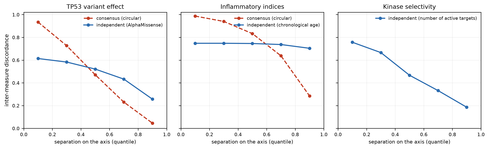

# A measurement-theoretic protocol for competing quantifications of latent biological concepts

*Polina Vinogradova*
Independent Researcher.
Correspondence: polina.vino@gmail.com. ORCID: 0000-0003-3271-3841.

> **Target:** *Journal of Theoretical Biology* (hybrid, traditional/subscription route, no APC).
> Elsevier "Your Paper Your Way" allows flexible formatting at initial submission. A formatting pass to
> JTB style (reference format, figure files) happens after the scientific draft is complete. This file
> is the canonical submission draft. `main.md` and `formal-spine.md` are the working notes it draws on.
> **All quantitative claims are copied from the stored analysis outputs** (`analysis/outputs/`,
> `tp53/analysis/outputs/`, `inflammation/analysis/outputs/`), which are the single source of truth.
> Each of those directories has a `run_all.sh` that regenerates every file in it. Figure 1 is built by
> `paper/make_figures.py`, which parses those same outputs rather than restating their numbers, so the figure
> cannot drift from the text.

---

## Highlights
- Competing biological measures of one concept are order-preserving extensions of a shared partial order.
- So disagreement is expected, and the output should say which pairs the concept orders, not pick a winner.
- A protocol separates concept-level (constitutive) from artefactual disagreement.
- Demonstrated on seven domains: kinase and serotonin selectivity, ageing, exposure, TP53, inflammation,
  cardiovascular risk.
- Cross-cohort reproducibility is the test of whether a disagreement is a property of the concept.

## Abstract
Many biological concepts are quantified by several competing formulas at once. Kinase-inhibitor selectivity,
biological age, the functional impact of a TP53 variant and inflammatory burden each have multiple defensible
measures that produce distinct rankings. The field's usual response is to benchmark them and choose a winner.
We argue this is mis-specified, and that each measure should instead be read as an order-preserving
representation of the concept's comparative structure. Admissible measures must agree wherever the concept's
order is determined, and can differ only on pairs the concept leaves incomparable, so once incomparabilities
exist no measure is canonical. What a comparison should report is where the concept decides and where it is
silent. Our contribution is a reusable protocol that operationalizes this view, with the controls that
separate constitutive disagreement (a concept property that survives cross-cohort reproducibility) from
artefactual disagreement (near-ties, detection-floor noise, decision-threshold boundaries). When a single
summary is unavoidable, we recommend the weight-free average rank over linear extensions, which commits no
further than the consensus order forces. We demonstrate the protocol on public data across seven domains,
reporting honestly where it is strong, where a domain differs, and where reproducibility is weak.

**Keywords:** measurement theory, partially ordered sets, convergent validity, rank aggregation,
biomarkers, variant effect prediction

---

## 1. Introduction

For many biological concepts, choosing how to measure them is part of defining them. To say that compound A
is more selective than B, that an intervention slowed someone's ageing, or that a genetic variant is more
damaging than another, one must first choose a number to stand for the concept. For most interesting
concepts several defensible numbers are in routine use. These are different formulas, not implementations
of one agreed formula, and on the same data they rank the same objects differently. Faced with this, the
literature typically benchmarks the candidates against some reference and declares a winner.

We argue that the benchmark question, *which measure is correct?*, is usually the wrong one, and that a
better question follows from an old and well-established view of what a measurement is. In representational
measurement theory (Krantz et al., 1971, Suppes et al., 1989, Luce et al., 1990), a measure is an
order-preserving map from a concept's comparative structure into the real numbers. When several indicators
target one concept, the orders consistent with all of them are exactly the *extensions* of the
partial order the indicators jointly induce (Patil and Taillie, 2004, Brüggemann and Patil, 2011). We
bring this view to biological measurement as a usable protocol.

Two consequences of the view are immediate and classical. First, any two admissible measures must agree
wherever the concept's order is determined, and can disagree only on pairs the concept leaves
**incomparable** (Section 2, Lemma 1). Second, whenever incomparabilities exist, the properties one would
demand of a "good" measure determine a whole *class* of admissible measures, one per extension, and
cannot single out a unique one (Szpilrajn, 1930, Section 2). So "no measure satisfies every requirement,
and none is canonical" is a theorem, not a failure of the field's effort. The output should therefore report
which pairs the concept orders, which it leaves incomparable, and, if a single number is unavoidable, what
the minimal-commitment summary is.

This reframing matters because the alternative is misleading. Benchmarking competing measures to a winner
treats concept-level ambiguity as estimation error to be resolved, when it may instead be a correct
description of a concept that does not totally order its objects. A TP53 variant with partial,
promoter-selective loss of function, a former smoker between clearly-exposed and clearly-unexposed, a
compound of intermediate selectivity: the concept itself may not order these objects. Reporting a single
ranking hides these cases.

**What is new here** is not the formalism, which is textbook and which we cite as foundation, but:

1. **A protocol** (Section 3) that operationalizes this view for a working analyst who has several measures
   and some cohorts, including the controls needed to avoid over-interpretation.
2. **A separation of constitutive from artefactual disagreement.** The situation is a *convergent-validity*
   problem (Campbell and Fiske, 1959). Psychometrics treats mid-range divergence as method variance to be
   removed. We show that part of it is *constitutive*, meaning the concept does not order some objects, and
   we give the reproducibility test that tells the two apart (Section 3, step 3).
3. **A cross-domain demonstration** on public data (Section 4) spanning kinase pharmacology, epigenetic
   ageing, serotonin pharmacology, methylation biomarkers, TP53 variant effect, inflammatory burden, and
   cardiovascular risk.
   Several of the seven domains yield null or negative results.

Persistent disagreement among a concept's measures is the observable evidence that the concept does not
totally order its objects.

Section 2 states the measurement-theoretic foundations and what follows from each. Section 3 gives the
protocol. Section 4 works through the seven domains. Section 5 reports what the demonstrations establish,
with scope. Section 6 discusses reporting practice and limits. Appendix A collects the formal statements.

---

## 2. Foundations

We fix the object and record which established result justifies which step of the protocol. Everything in
this section is classical or definitional. Fuller statements and proofs are in Appendix A.

**The object.** Fix a latent concept κ (selectivity, biological age, variant impact, inflammatory burden) and
a finite set of objects Ω. Domain knowledge licenses *comparative judgments* a ≽ b ("a is at least as κ as
b"). The empirical structure is (Ω, ≽) with ≽ a preorder that is **not** assumed total. Write a ∥ b when
neither direction is supported, meaning a and b are *incomparable*. A *measure* f : Ω → ℝ is **admissible** if
a ≽ b implies f(a) ≥ f(b) and a ≻ b implies f(a) > f(b), an order-preserving homomorphism, which is the
representation condition of measurement theory. Two measures belong to the same **family** if they induce the
same total preorder. A family is an equivalence class under strictly monotone reparameterization, that is, an
*ordinal* class (Lemma 2). We adopt the multiple-indicators-to-partial-order-to-linear-extensions setup of
Patil and Taillie (2004).

**Disagreement lies in the incomparable set (Lemma 1).** If two admissible measures rank a pair in
opposite strict directions, that pair is incomparable under κ. Equivalently, admissible measures agree on
the strict order of every comparable pair, and all inter-measure reversals lie among the incomparabilities.
This justifies protocol step 2.

**The order is estimated by consensus, and the estimate over-declares comparability.** The true ≽ is not
observed. Given the set 𝓜 of measures experts actually use, define the consensus order a ≽𝓜 b iff
f(a) ≥ f(b) for every f in 𝓜. Under the assumption that every reasonable measure is admissible, ≽ ⊆ ≽𝓜,
so the consensus can mark a pair as comparable when the measures agree by coincidence though κ leaves
it incomparable. Two checks make the estimate trustworthy. Cross-cohort reproducibility treats a
disagreement that replicates across independent cohorts as a property of κ rather than of the sample
(protocol step 3). A crude external anchor for the concept should agree with the consensus at the
extremes, and disagreement there indicates that the whole set of measures is mis-oriented (step 1).

**No measure is canonical once incomparabilities exist.** On a finite (Ω, ≽), the class of admissible measures
is non-empty (Szpilrajn, 1930) and, up to family, is in bijection with the extensions of ≽, with a
unique element iff ≽ is total (standard order theory). If any pair is incomparable there are at least two
order-distinct admissible measures, and no requirement that only entails order-preservation can single one
out. This justifies step 6. Benchmarking to find the correct measure is mis-specified, and the correct output
is the comparability skeleton plus the reproducible incomparable set. The same conclusion appears in social
choice (Arrow, 1963) and truth-discovery axiomatics (Singleton and Booth, 2022).

**The minimal-commitment summary.** When a single number is unavoidable, the average rank of each object
over the linear extensions of the consensus poset (Patil and Taillie, 2004, De Loof et al., 2008, 2011) is
the barycenter of the rank vectors of those extensions under the uniform distribution on them. It agrees
with every admissible measure on the comparable pairs, and on each incomparable pair it settles the order
by mean rank instead of preferring either object. The finer summary, which settles no incomparable pair, is
the mutual-rank-probability matrix, whose entry for a pair is the fraction of extensions ranking one object
above the other. The average rank is weight-free and parameter-free. Counting the linear extensions of a
finite poset is #P-complete (Brightwell and Winkler, 1991), so exact average ranks are #P-hard and are
estimated by near-uniform sampling (Bubley and Dyer, 1999). This resolves the
non-uniqueness above, and it justifies step 7. It is canonical *relative to*
the chosen base set 𝓜, so the choice of which measures to admit is real and only lifted one level, not
eliminated (Section 6).

**A scale-type caution.** Families are ordinal classes only (Lemma 2). Two admissible measures being
linearly related on one dataset does not establish a shared interval scale. A linear relation is expected,
for instance, when both are regressions on a shared external target. A non-affine monotone relation between
two measures, such as rate versus position clocks, is a descriptive observation rather than a scale-type
proof. The protocol reports relations between families descriptively and does not assign interval or ratio
structure it cannot establish.

---

## 3. The protocol

Input: a latent concept κ, a set Ω of objects, candidate measures f₁ … f_k each claiming to quantify κ,
and ideally at least two independent cohorts. Each step names the established result that justifies it
(Section 2, Appendix A).

1. **Declare type and scale, and verify orientation against an external anchor.** State, for each measure,
   what comparative structure it represents and its scale of measurement. Measures of different declared types
   are not rival estimates of one number. Then check that each measure moves with a crude, theory-light
   external proxy for the concept (number of active targets for selectivity, chronological age for clocks,
   clinical labels for variant effect, mortality for inflammation). A measure can pass every internal
   stability check and still be oriented the wrong way. Only an external anchor catches a set of measures that
   are all mis-oriented.
2. **Compute the consensus order and the disagreement set.** Form the partial order in which a ≽ b iff every
   measure ranks a ≥ b. The pairs on which the measures disagree are the candidate incomparabilities (Lemma
   1).
3. **Test reproducibility, the constitutive/artefactual split.** Recompute the consensus order and the
   disagreement set in each cohort separately. Disagreement that reproduces across independent cohorts is
   evidence of concept-level incomparability (constitutive). Disagreement that does not is sampling noise or
   method variance (artefactual). This is the step that distinguishes the protocol from a convergent-validity
   audit.
4. **Locate disagreement, with controls.** Before claiming disagreement concentrates anywhere, control for
   object separation on the concept axis (near-ties trivially disagree), local density, distance to any
   decision threshold, and rank-boundary compression. Report only what survives. The separation axis must be
   chosen with care: a consensus axis built from the measures under comparison is partly circular, because
   disagreement about a pair mechanically pulls that pair's consensus position together. Use an axis
   independent of those measures where one exists, and where none does, report the consensus-axis result as an
   upper bound on the constitutive component rather than as an estimate of it. In the two domains
   where both axes are available, the consensus-axis decline is 2.5 and 16 times the independent-axis
   decline.
5. **Cluster measures into families and score them against desiderata.** Group measures by the order they
   induce. Then fill a domain-independent checklist, recording which measures satisfy each criterion: a
   reliability/domain gate, monotonicity in the concept against the anchor, ordinal stability under nuisance,
   cross-cohort reproducibility, and intervention consistency.
6. **Report the full structure, not a single winner.** Because no measure is canonical when incomparabilities
   exist, report the consensus order, the reproducible incomparable set, the families, and which of the
   step-5 desiderata each family satisfies.
7. **If a single summary is unavoidable, use the minimal-commitment canonical aggregate.** Compute the average
   rank over the linear extensions of the consensus poset. Benchmark existing measures against it to see which
   is the best single proxy and which claim more than the consensus supports.

The protocol's value is concentrated in steps 3 and 4. Without them, naive disagreement metrics
report structure that disappears once the proper controls are applied (Section 5).

---

## 4. Worked demonstrations

We apply the protocol in seven domains, all on public data. The domains differ in maturity and in how well
the protocol's assumptions hold. Kinase selectivity is the running example and the most
developed. TP53 variant effect and inflammatory burden are the newest and most data-rich. Every number
below is copied from a stored analysis output in the project repository. Table 1 summarises the instances and
the coverage of the protocol's steps across them.

**Table 1.** The ten instances the protocol is applied to, grouped into the seven domains of this section.
*Incomparable* is the fraction of object pairs the consensus poset leaves unordered. *Best proxy* is the
existing measure whose ranking correlates most strongly (Spearman) with the weight-free average rank over
linear extensions. A dash marks a quantity not computed for that instance: the poset and average-rank steps
were run where the object set was large enough to support them, and the remaining instances were used for the
family-structure and orientation steps only. The inflammatory-index poset is computed on a fixed random
subsample because pair counts scale quadratically. Every value is copied from a stored analysis output.

| Instance | Measures | Objects (poset) | Incomparable | Best proxy | Cross-cohort reproducibility |
|---|---|---|---|---|---|
| Kinase selectivity (4.1) | 4 | 206 gated compounds | 37.2% | Gini, 0.955 | not tested |
| Blood clocks (4.2) | 5 | 1,385 samples | — | — | not tested |
| Retinal clocks (4.2) | 5 | 85 samples | — | — | single cohort |
| Serotonin selectivity (4.3) | 4 | 297 ligands | — | — | not tested |
| Smoking signatures (4.4) | 4 | 464 and 689 samples | — | — | divergence replicates in both |
| TP53 variant effect (4.5) | 9 | 2,314 variants | 56.6% | median-of-8 promoters, 0.987 | platforms agree at the extremes |
| Inflammatory indices (4.6) | 7 | 600 of 5,327 participants | 72.8% | SII, 0.983 | Spearman 0.995 |
| Sepsis signatures (4.6) | 5 | 479 samples | 79.2% | interferon-γ, 0.756 | Spearman 0.32 |
| Inflammaging clocks (4.6) | 5 | 343 samples | 54.1% | — | qualitative only |
| Cardiovascular risk (4.7) | 3 | 600 of 2,994 adults | 15.5% | — | mean Δr 0.004 |

### 4.1 Kinase-inhibitor selectivity
Concept: how concentrated an inhibitor's activity is across the kinome. Measures: the S-score, selectivity
entropy, the Gini coefficient, and target-ratio, applied across four profiling datasets spanning three
assay technologies (Davis et al., 2011, 68 compounds, Klaeger et al., 2017, 222, Anastassiadis et al.,
2011, 178, Metz et al., 2011, 704, with prior comparisons of these metrics by Uitdehaag and Zaman, 2011,
and Bosc et al., 2017). The measures split into two families. The S-score, entropy, and Gini quantify
concentration across the panel and agree closely (within-family Spearman 0.72 to 1.00), while the
target-ratio quantifies the gap to one off-target and is the consistent outlier (cross-family 0.14 to
0.62). On the reliability-gated Klaeger compounds the consensus poset leaves **37.2% of pairs incomparable**,
and against the weight-free average-rank aggregate the Gini (0.955) and entropy (0.950) are the best
single proxies while the ratio (0.796) agrees least. Pairwise discordance is
driven by separation measured on the number of active targets, an axis independent of the four measures
(equal-active-count pairs are 76% discordant, well-separated pairs 19%), and axis position adds essentially
nothing once separation is controlled (added R² about
0.002). Compounds with no activity above the detection floor carry the largest instability (rank standard
deviation 72.9 versus 31.3 for active compounds), which is why the reliability gate is the first
desideratum. No existing measure satisfies the four selectivity desiderata we draw from these failures
(a reliability gate, bounded gap sensitivity, distributional consistency, and monotonicity under weak
off-target addition), while a gated smooth-hinge effective-target number does.

### 4.2 Epigenetic clocks (biological age)
Concept: biological age. Measures: DNA-methylation clocks of three declared *types*, which the protocol's
step 1 keeps separate rather than pooling. Position clocks report where a sample is on the ageing
trajectory, deviation clocks report departure from it, and rate clocks report speed along it (1,385 blood
samples, GSE40279 and GSE87571). Rate clocks such as DunedinPACE (Belsky et al., 2022) are one declared
type, and independent comparisons confirm that clocks disagree and differ in predictive value
(Mavrommatis et al., 2025). The single-linear clocks are affine-related to one another (R² 0.992 to
0.995, over the position clocks Horvath and Hannum and the deviation clock PhenoAge), and the rate clock
relates to them through a signed logarithm (R² 0.93 to 0.95), a Weber-Fechner-like relation that is a
descriptive observation, not a scale-type proof (Section 2). Every clock tested against cell-type
composition fails an ordinal-stability check (absolute correlation up to 0.372, over Horvath, Hannum,
PhenoAge and GrimAge, with DunedinPACE not tested), and the four clocks with a single published
coefficient vector are near-orthogonal to each other (pairwise cosine between −0.17 and 0.11), so they
agree on age while sharing almost no CpGs. GrimAge is a two-stage composite with no single coefficient
vector, so it cannot enter that comparison. The
external anchor here, chronological age, is the training target of the position clocks, so for them the
orientation check is confirmatory rather than independent.

The clock idea is not specific to blood or to methylation. On a rat retinal bulk RNA-seq aging series
(GSE314970, 85 samples over 6 to 27 months, Shavlakadze et al., 2026), five competing transcriptomic aging
measures disagree sharply: the SenMayo and Fridman senescence signatures (Saul et al., 2022, Fridman and
Tainsky, 2008), a Hallmark inflammatory inflammaging proxy, and a fitted elastic-net clock. Against true age
they range from Spearman 0.98 for the fitted clock down to 0.13 for the Fridman senescence-up signature. The
curated senescence signatures are weak age predictors on their own. The five measures split into a senescence
and inflammaging family plus a distinct fitted-clock direction, with the Fridman senescence-down signature
anti-correlated with the rest of the senescence block. The mean-rank consensus tracks age (Spearman 0.755) and
mean age rises monotonically across consensus tertiles (9.7, 18.3, 22.7 months), and discordance falls with
separation on the consensus axis as elsewhere, though even well-separated pairs still disagree about half the
time. This is a single-cohort, rat, single-sex extension with the clock trained in-distribution, so it is
qualitative, on par with the inflammaging clocks. It shows the clock family structure and the near-tie pattern
recur in a new tissue and a new measurement modality. Full analysis is in the companion clock repository
`epigenetic-clock-desiderata`, subdirectory `eye_aging/`.

### 4.3 Serotonin-receptor selectivity
Concept: 5-HT2A versus 5-HT2B selectivity. The kinase selectivity measures transfer directly, on binding
affinities from ChEMBL (Zdrazil et al., 2024, n=297) and on a hand-curated set of classical psychedelics
scored against the NIMH Psychoactive Drug Screening Program Ki database (PDSP Ki Database, 2026, n=36). The
family structure recurs. Here entropy is the outlier (its correlation with the others is near zero, while the
S-score and Gini agree at +0.682 once both are oriented towards selectivity), whereas in kinase the ratio was
the outlier. Across domains the consensus order still agrees with the external anchor (number of active
targets, Spearman about 0.82, on the broader 949-compound set with at least four receptors measured).
Cross-domain transfer is weakest in this domain: discordance stays high even for well-separated compounds, so
the near-tie account explains less here than elsewhere. Separation is on the consensus axis, which inflates
the effect in other domains, so that weakness is if anything understated.

### 4.4 Methylation exposure biomarkers
Concept: environmental exposure or disease signature. Measures: competing smoking-exposure signatures (AHRR,
Breitling et al., 2011, EpiSmoke, Shenker et al., 2013, Joehanes, Joehanes et al., 2016, and EpiTob,
Chamberlain et al., 2022) across two cohorts (GSE50660, Tsaprouni et al., 2014, n=464, and GSE42861,
Liu et al., 2013, n=689). The signatures agree almost
perfectly on never-smokers (96%) and well on current smokers (82%), and diverge on former smokers (71% pooled,
78% and 66% per cohort). The divergence reproduces in both cohorts separately, which rules out sampling noise,
but it is artefactual rather than constitutive: it is a threshold effect at the classification cutoff, and
which group agrees worst changes when the cutoff changes, so it is not evidence of a concept-level
"consequential middle" (Section 5). A cross-tissue arm (fetal alcohol spectrum disorder) shows why the
reliability gate is needed. Buccal-derived signatures (Portales-Casamar et al., 2016, Lussier et al., 2018)
scored on blood transfer poorly (AUC 0.68 to 0.79), and the one strong blood-native episignature
(van der Laan et al., 2025, AUC 0.93 to 0.96) is non-independent of its evaluation cohort (shared laboratory
and tissue, confirmed by the depositing author), so it is an upper bound only.

### 4.5 TP53 variant effect Concept: the functional impact of a TP53 missense variant. Measures: eight
Kato/Ishioka yeast transactivation readouts (Kato et al., 2003), seven computational pathogenicity predictors,
namely AlphaMissense (Cheng et al., 2023), EVE (Frazer et al., 2021), ESM1b (Brandes et al., 2023), REVEL
(Ioannidis et al., 2016), CADD (Kircher et al., 2014, with the v1.6 scores of Rentzsch et al., 2021),
PrimateAI (Sundaram et al., 2018) and BayesDel (Feng, 2017), the last four taken from dbNSFP v4.1a (Liu et
al., 2020), and mammalian proliferation screens (Giacomelli et al., 2018, Kotler et al., 2018, via ProteinGym,
Notin et al., 2023), with ClinVar (Landrum et al., 2018) as the external clinical anchor and the ClinGen TP53
specifications (Fortuno et al., 2021) for the field's functional rules (core panel 2,314 variants). Step 1 is
necessary here. The eight transactivation readouts and AlphaMissense are correctly oriented against ClinVar
(AUC 0.96 to 0.99), while all four proliferation screens are mis-oriented (AUC 0.016 to 0.064) under the naive
"higher fitness is worse" convention, so they must be flipped before use. The fifteen core-panel measures form
two families by measurement basis, the eight transactivation readouts (within-family mean 0.78) and the seven
predictors (mean 0.76), agreeing less across the two blocks (mean 0.50) than within either. The proliferation
screens are held out of the family analysis, and the three Giacomelli conditions serve instead as the
independent mammalian platform in the reproducibility test below. The consensus poset over the nine base
measures (the eight readouts plus AlphaMissense) is 56.6% incomparable, and the field's own
median-of-eight-promoters rule is the best proxy for the average-rank aggregate (Spearman 0.987) while all
seven predictors sit well below it (0.46 to 0.60). The consensus discriminates ClinVar labels at AUC 0.997.
Disagreement is again separation-driven, but the size of the effect depends on how separation is measured. On
the consensus axis, which is built from the same measures, discordance falls from 0.93 for near-ties to 0.05
for well-separated pairs. On an independent AlphaMissense axis it falls only from 0.61 to 0.26 (Figure 1). The
effect survives the removal of that circularity at about 40% of its apparent size, and we take the
independent-axis figure as the size of the constitutive component. A modest genuine middle residual also
survives control (mid-axis coefficient +0.33 on the consensus axis, +0.10 on the independent axis),
corresponding to partial-loss-of-function variants. Two experimental *platforms*, yeast transactivation and
mammalian proliferation, agree strongly at the extremes (+0.63) and not at all in the middle (−0.05), so the
comparability skeleton is constitutive across platforms while the middle is genuinely undecided. Finally, all
seven predictors score 0.90 to 0.99 against curated ClinVar but only 0.79 to 0.89 against the independent
functional truth on the variants of uncertain significance where prediction is actually used, so evaluation
against curated labels overstates their performance (Section 5). A hotspot-codon holdout showed no inflation
for any predictor, an honest null.

### 4.6 Inflammatory burden Concept: systemic inflammatory burden, quantified three ways of differing
strength. **Clinical indices (strong):** seven routine indices (NLR, PLR, MLR, SII, SIRI, CRP, CRP-to-albumin)
on two independent NHANES cycles, anchor all-cause mortality. Two families emerge by measurement basis,
leukocyte-count ratios and CRP-protein, nearly independent of each other (between-family mean 0.19), and CRP
and its albumin ratio are rank-identical (1.00), so one is redundant. The consensus discriminates mortality at
the extremes (AUC 0.69) but not the middle (0.51), and its inter-index correlation structure replicates across
the two cycles at Spearman **0.995**, the strongest reproducibility in this work. Disagreement falls steeply
with separation on the consensus axis (0.987 for near-ties to 0.285 for well-separated pairs) but is flat on
the only independent axis available here, chronological age (0.748 to 0.704, R² 0.0015, Figure 1). Age is too
weak a proxy for inflammatory burden to settle which reading is right, so we report both. **Sepsis signatures
(strong disagreement, weak reproducibility):** five published blood signatures (the Hallmark inflammatory and
interferon-γ sets, Liberzon et al., 2015, the SRS7 Sepsis Response Signature, Davenport et al., 2016, the
SRSq19 SepstratifieR signature, Cano-Gamez et al., 2022, and the MARS8 endotype signature, Scicluna et al.,
2017) on GSE65682, scored on the 479 of 802 samples carrying 28-day mortality, which is also the anchor. The
Hallmark and SRS families are near-independent (cross-family mean +0.02), and the detailed structure
replicates only weakly across the discovery and validation cohorts (Spearman 0.32). Four of the five
mortality-orientation signs match across the two cohorts, while MARS8's flips, consistent with its near-chance
raw AUC of 0.495. **Inflammaging clocks (thin):** only two composite clocks are publicly reconstructable on
shared samples, SImAge (Kalyakulina et al., 2023) and a recomputed ipAGE (Yusipov et al., 2022). Two further
inflammaging clocks, iAge (Sayed et al., 2021) and IMM-AGE (Alpert et al., 2019), are not reconstructable
here, so this is a qualitative check, not a full instance. Sepsis *endotype labels* (SRS versus MARS) are
partitions rather than scalar orders, so the right comparison for them is cluster agreement rather than
average rank. Only the signature scores are analysed with the protocol.

### 4.7 Cardiovascular risk
Concept: ten-year risk of a cardiovascular event. Measures: three published scores in routine clinical use,
the ACC/AHA Pooled Cohort Equations (Goff et al., 2014), and the Framingham general-CVD laboratory and office
models (D'Agostino et al., 2008), the last substituting body-mass index for the lipid panel. Cohorts: NHANES
2015-16 (n=2,994) and 2017-18 (n=2,913), adults aged 40 to 79 with complete risk factors. The anchor is
cause-specific cardiovascular death from the NHANES Linked Mortality File, with all-cause death reported
alongside because the cardiovascular event count is small (30 and 10). All three are correctly oriented
against both anchors (cardiovascular-death AUC 0.755 to 0.815).

This domain behaves unlike the others, and the contrast is the reason for including it. The three scores do
not split into families: they agree on ranking almost perfectly (Spearman 0.932 to 0.946 in both cycles) and
that structure is the most stable in this work, reproducing across cycles to a mean absolute difference of
0.004. The consensus poset still leaves 15.5% and 15.7% of pairs incomparable, the lowest of any instance in
Table 1. Yet the three scores disagree on absolute risk by about a factor of two, with median ten-year risk
7.5% under the Pooled Cohort Equations against 15.3% under the Framingham office model. Because treatment
guidelines act on a threshold rather than on a ranking, that calibration gap converts near-identical orderings
into opposite clinical decisions: at the 7.5% statin-eligibility threshold, **26.2% of adults in 2015-16 and
26.6% in 2017-18 are classified differently depending on which score is used**, and the figures are
essentially unchanged at the 10% threshold (25.9% and 26.9%).

The protocol's distinction explains the apparent paradox. Rank agreement and decision agreement are different
properties, and a measure set can be nearly unanimous on the first while splitting on the second. Step 1's
requirement to declare scale type is what catches this: these three scores agree ordinally but not on the
interval or absolute scale the threshold rule presupposes, so the guideline treats as comparable a quantity
the measures do not jointly determine. The disagreement here is artefactual in the protocol's sense, a
decision-threshold boundary effect rather than concept-level incomparability, but it is the instance where an
artefactual disagreement carries the largest practical cost. Discordance falls with separation as elsewhere
(0.444 to 0.000), but the only available separation axis is the consensus, and age and blood pressure are
inputs to all three scores, so no independent axis can be constructed here and that decline is an upper bound
(Section 3, step 4). Analysis is in `cvdrisk/`.

## 5. What the demonstrations establish

With the protocol's controls applied, the honest and reproducible findings are the following. They are
less sweeping than "one phenomenon recurs identically in seven domains."

1. **Disagreement is concentrated in near-ties, by an amount that depends on how separation is measured.**
   Discordance falls as objects separate on the concept axis in most domains, but both the size of the fall
   and, in two domains, whether it falls at all depend on whether the separation axis is independent of the
   measures being compared. On independent axes it falls from 76% to 19% in kinase (axis: number of active
   targets) and from 0.61 to 0.26 in TP53 (axis: AlphaMissense). Figure 1 shows the two axes side by side. On
   consensus axes, built from the same measures and so partly circular, the declines are larger: 0.93 to 0.05
   in TP53, and 0.987 to 0.285 for the inflammatory indices, which have no strong independent axis and are
   flat on the weak one available. Serotonin compounds disagree even when well separated. We therefore read
   the independent-axis figures as the size of the constitutive component and the consensus-axis figures as
   upper bounds. Once separation is controlled, axis position adds little or nothing, so the claim that
   measures split on an "interesting middle" is largely a near-tie and rank-boundary artefact and we retire it
   as a general law. TP53 retains a small genuine middle residual (partial-loss-of-function variants) that
   shrinks but does not vanish on the independent axis.

**Figure 1.** Inter-measure discordance against object separation, for the three instances with an axis
independent of the measures being compared. Each point is a quantile bin of pairs. Where the separation axis
is the consensus mean-rank (red, dashed), it is built from the same measures whose discordance is plotted, so
near-ties and disagreement are linked by construction as well as by the concept. Where the axis is independent
of those measures (blue, solid), the decline is smaller in TP53 and absent for the inflammatory indices, whose
only available independent axis, chronological age, is a weak proxy for the concept. For kinase only the
independent axis was computed, so no consensus curve is shown. Generated by `paper/make_figures.py` directly
from the stored analysis outputs.

2. **Detection-floor and out-of-domain instability is real and gate-necessary.** The largest inter-measure
   disagreement occurs where the signal is weakest, at the kinase detection floor (rank standard deviation
   72.9 versus 31.3), and out-of-domain transfer degrades the measures themselves, with cross-tissue
   methylation signatures falling to AUC 0.68 to 0.79. This is the region the reliability and domain gate
   excludes.

3. **Families recur, but the identity of the outlier does not.** Measures partition into a low-disagreement
   cluster plus at least one categorically different measure in kinase, serotonin, TP53, and the inflammatory
   indices. Which measure is the outlier is domain- and panel-dependent (the ratio in kinase, entropy in
   serotonin, the computational block in TP53, the CRP-protein pair in the indices).

4. **Field heuristics often approximate the minimal-commitment aggregate.** Where a field already uses an ad
   hoc summary, it is frequently close to the weight-free average-rank aggregate. The TP53 community's
   median-of-eight-promoters rule proxies it at Spearman 0.987, and in kinase the Gini and entropy proxy it at
   about 0.95. The protocol here supports existing practice rather than overturning it, and quantifies which
   measures sit furthest from the aggregate (the ratio in kinase at 0.796, the predictors in TP53 at 0.46 to
   0.60).

5. **Reproducibility is domain-dependent, and the test shows it.** The constitutive/artefactual test gives
   sharply different verdicts across domains. The disagreement structure of the inflammatory indices
   replicates across independent NHANES cycles at Spearman 0.995, while sepsis-signature structure replicates
   only weakly (0.32) and one signature's orientation flips between cohorts. The test separates a stable
   concept-level disagreement from a partly sample-specific one, and it cautions against assuming that any
   single instance's reproducibility generalises.

6. **External anchors confirm orientation and catch mis-orientation.** Across domains the consensus order
   agrees with a crude external anchor (Spearman about 0.65 to 0.94). Where the anchor is continuous enough to
   separate extremes from middle, agreement is stronger at the extremes than in the middle (kinase 0.92 versus
   0.56, clocks 0.68 versus 0.36). The check flagged an un-gated kinase candidate whose orientation was
   reversed, and it flagged all four TP53 proliferation screens as mis-oriented under the naive fitness
   convention. Two anchors are training targets or coincide with the outcome used to orient (position
   clocks against age, sepsis signatures against mortality), so those two checks are confirmatory rather
   than independent.

A related observation, established most cleanly in TP53 and in the QSAR setting, is that *evaluations*
overstate performance when the benchmark overlaps the training signal. That is a different failure from
*definitions* disagreeing, and we report it separately.

The framing is not new. That multiple operationalisations of one construct disagree is convergent validity
(Campbell and Fiske, 1959), and the raw "agree at the extremes, diverge in the middle" pattern is the
textbook Bland-Altman range effect (Bland and Altman, 1995). What this paper adds is the reproducibility
test that reclassifies a disagreement from method variance to a property of the concept, and the controls
that decide which disagreement is which.

## 6. Discussion

**Reporting practice.** The protocol implies concrete changes to how competing measures are reported. Declare
each measure's type and scale, and verify its orientation against an external anchor, before any comparison
(step 1). Report the reproducible incomparable set and the per-family desiderata verdicts rather than a single
ranking (step 6). Validate a measure in its native domain, tissue, or panel rather than assuming transfer (the
reliability gate, Sections 4.4 and 4.6). When a single number is unavoidable, report the average-rank
canonical aggregate and each measure's distance from it, rather than an arbitrary favourite (step 7).

**The conceptual claim.** Some disagreement among biological measures is not a defect to be benchmarked away.
It reflects a concept that does not totally order its objects. The protocol's job is to find the part of the
disagreement that is real and reproducible, and to stop arguments about the part that is not real. As a claim
about biology: several important concepts, including selectivity, biological age, variant impact, and
inflammatory burden, are only partially ordered by their own objects, and the persistent disagreement of
their measures is evidence of that partial order.

**Limitations.** Four are substantive. First, the base set is a choice. The consensus order, the incomparable
set, and the canonical aggregate are all defined relative to the set of measures admitted, and there is no
closed enumeration of "all measures" of a biological concept. We mitigate this with a stated selection rule
(measures in routine use, computable on the data, distinct in the order they induce), with robustness checks,
and by reporting the base set explicitly, but the choice itself remains.
Second, the reproducibility evidence is uneven. It is strong for population indices and thin or weak
elsewhere, and one domain (sepsis) replicates only weakly. Third, two external anchors are not independent of
the measures they check (chronological age is the training target of position clocks, mortality is used to
orient the sepsis signatures), so those orientation checks are confirmatory. Fourth, the framework assumes a
concept-level order exists and that reasonable measures respect it. This is one substantive assumption, argued
rather than proved. It also restricts scope to scalar orders, so categorical *endotype* systems fall
outside the protocol (Section 4.6).

**Scope and relation to prior work.** The formalism is entirely borrowed. It is representational
measurement theory (Krantz et al., 1971), the partial-order theory of multi-indicator systems (Patil and
Taillie 2004, Brüggemann and Patil, 2011), Szpilrajn's extension theorem, and the average-rank canonical
extension (De Loof et al., 2008). The clearest prior application of measurement theory in biology (Houle et
al., 2011) treats single measurements and scale types rather than competing measures of one concept as
extensions of a shared partial order. The partial-order approach has precedent in environmental chemistry
(Halfon and Reggiani, 1986) and in social indicators (Fattore, 2016), and it contrasts with
rank-aggregation methods that force a consensus (Dwork et al., 2001, Kolde et al., 2012) rather than
preserve incomparability. An early biological example is the concordance among breast-cancer
gene-expression predictors (Fan et al., 2006), which share few components yet agree where the concept is
determined. Our contribution is the protocol, the constitutive/artefactual
reproducibility test, and the cross-domain demonstration on public data. For a working analyst, it gives a
reusable procedure for the common situation where several defensible measures of one latent concept do not
agree.

---

## Declarations

**Declaration of competing interest.** The author declares no competing financial or personal interests.

**Funding.** This research received no external funding.

**Declaration of generative AI in scientific writing.** During the preparation of this work the author
used Claude (Anthropic) to assist with data acquisition, analysis scripting, and drafting. The author
reviewed and edited all output and takes full responsibility for the accuracy and integrity of the work.

**Data and code availability.** All analyses use publicly available data and are fully reproducible from
the project repository. For each domain the repository contains a README documenting data provenance and
the measure-selection rule, the analysis scripts, and their stored outputs. *Repository URL and an archived
DOI (Zenodo) to be added on submission.*

**CRediT author contributions.** Polina Vinogradova: conceptualization, methodology, software, formal
analysis, investigation, writing – original draft, writing – review and editing.

---

## Appendix A — formal justification

This appendix states which established result justifies which step of the protocol, and fixes the object
so the steps are well-defined. Every result is classical or definitional.

**Definition 1 (the object).** Fix a latent concept κ and a finite object set Ω. The empirical structure
is (Ω, ≽), where ≽ is a preorder (reflexive and transitive) that is not assumed total. Write a ~ b when
both a ≽ b and b ≽ a, write a ≻ b for strict order, and write a ∥ b when neither a ≽ b nor b ≽ a
(a and b are incomparable).

**Definition 2 (admissible measure).** A measure is a map f : Ω → ℝ. It is admissible if a ≽ b implies
f(a) ≥ f(b) and a ≻ b implies f(a) > f(b). This is the order-preserving representation condition of
representational measurement theory. Write 𝓕(≽) for the admissible measures.

**Definition 3 (families, weak extensions, linear extensions).** A measure f induces a total preorder on Ω:
write a ⪰_f b iff f(a) ≥ f(b), and write ≻_f for its strict part. Two measures are in the same *family* when
they induce the same total preorder. A total preorder on Ω is a *weak extension* of ≽ when it preserves the
concept's weak and strict comparisons alike: a ≽ b implies a ⪰_f b, and a ≻ b implies a ≻_f b. A weak
extension that is antisymmetric, so that it leaves no two distinct objects tied, is a *linear extension* in
the standard order-theoretic sense. On finite Ω, f ↦ ⪰_f maps 𝓕(≽) onto the weak extensions of ≽, and the
linear extensions are the tie-free ones among them. The distinction matters because an admissible measure may
assign two incomparable objects the same value, whereas the aggregate below averages over linear extensions
only. Throughout, ≽ and ≻ are the concept's order and ⪰_f and ≻_f the order a measure induces. This is the
multiple-indicators-to-partial-order setup of Patil and Taillie (2004).

**Consensus (how ≽ is estimated).** Given the set 𝓜 of measures in use, define a ≽𝓜 b iff f(a) ≥ f(b) for
every f in 𝓜. If every reasonable measure is admissible for the true ≽, then ≽ ⊆ ≽𝓜, so the consensus
over-declares comparability. The comparable pairs of ≽𝓜 are an upper bound on the truly comparable pairs,
and the incomparable pairs of ≽𝓜 are a lower bound on the truly incomparable pairs. Reproducibility across
independent cohorts (protocol step 3) is the evidence that a reproducible incomparability is a property of
κ and not an accident of one sample. An external anchor (step 1) is a second, independent check.

**Lemma 1 (disagreement lies in the incomparable set).** If f, g in 𝓕(≽) strictly disagree on a pair,
meaning f(a) > f(b) while g(a) < g(b), then a ∥ b. *Proof.* If a ≽ b then admissibility of g gives
g(a) ≥ g(b), a contradiction. If b ≽ a then admissibility of f gives f(b) ≥ f(a), a contradiction. So
a ∥ b. This is the contrapositive of admissibility. For the estimated order ≽𝓜 it holds by construction,
and its role is only to justify step 2.

**Lemma 2 (families are ordinal classes).** If f, g in 𝓕(≽) are in the same family, there is a strictly
increasing φ with g = φ ∘ f, and conversely any strictly increasing φ gives a same-family measure. *Proof.*
Define φ(f(a)) := g(a). It is well-defined and strictly increasing because f and g induce the same order. So a
family is an equivalence class under strictly monotone reparameterisation, an ordinal class.
Linear-relatedness on a dataset therefore does not establish a shared interval scale, and a non-affine but
strictly increasing relation between two measures keeps them in the same family. Family membership is
diagnosed by rank agreement, not by the regression form relating two measures.

**Proposition (non-uniqueness).** On finite (Ω, ≽): 𝓕(≽) is non-empty, the families are in bijection with
the weak extensions of ≽, and there is a unique family iff ≽ is total. *Proof.* Szpilrajn's extension
theorem gives a linear extension, which is a weak extension, and which on a finite set has a real
representation and is admissible. Conversely a weak extension is realised by numbering its levels. A finite
poset has a unique weak extension iff it is total. If a ∥ b, both a ≻ b and b ≻ a extensions
exist. So when incomparabilities exist there are at least two order-distinct admissible measures, and no
requirement that only entails order-preservation can single one out. This justifies step 6.

**The canonical aggregate.** When a single summary is required, the average rank of each object over the
linear extensions of ≽𝓜 (Patil and Taillie, 2004, De Loof et al., 2008) is the barycenter of the rank
vectors {rank_⪰ : ⪰ ∈ Lin(≽𝓜)} under the uniform distribution on Lin(≽𝓜). It agrees with every admissible
measure on the comparable pairs, and on each incomparable pair it breaks the tie by mean rank, favouring
neither object. The finer summary is the mutual-rank-probability matrix, whose entry for a pair is the
fraction of extensions ranking one object above the other. The average rank is weight-free and
parameter-free. Counting the linear extensions of a finite poset is #P-complete (Brightwell and Winkler,
1991), so exact average ranks are #P-hard and are estimated by near-uniform sampling (Bubley and Dyer,
1999). The average rank is canonical relative to the chosen base set 𝓜. This justifies step 7.

## References

*Elsevier name-date (Harvard) style; DOIs verified against primary/publisher records. `[UNVERIFIED]` tags mark
residual gaps to confirm at proof. Journal house style (including semicolon-separated in-text citation lists)
is applied by the journal at proof.*

Alpert, A., Pickman, Y., Leipold, M., Rosenberg-Hasson, Y., Ji, X., Gaujoux, R., Rabani, H., Starosvetsky, E.,
Kveler, K., Schaffert, S., Furman, D., Caspi, O., Rosenschein, U., Khatri, P., Dekker, C.L., Maecker, H.T.,
Davis, M.M., Shen-Orr, S.S., 2019. A clinically meaningful metric of immune age derived from high-dimensional
longitudinal monitoring. Nature Medicine 25, 487–495. https://doi.org/10.1038/s41591-019-0381-y

Anastassiadis, T., Deacon, S.W., Devarajan, K., Ma, H., Peterson, J.R., 2011. Comprehensive assay of kinase
catalytic activity reveals features of kinase inhibitor selectivity. Nature Biotechnology 29, 1039–1045.
https://doi.org/10.1038/nbt.2017

Arrow, K.J., 1963. Social Choice and Individual Values, 2nd ed. Wiley, New York.

Belsky, D.W., Caspi, A., Corcoran, D.L., Sugden, K., Poulton, R., Arseneault, L., Baccarelli, A., Chamarti,
K., Gao, X., Hannon, E., Harrington, H.L., Houts, R., Kothari, M., Kwon, D., Mill, J., Schwartz, J., Vokonas,
P., Wang, C., Williams, B.S., Moffitt, T.E., 2022. DunedinPACE, a DNA methylation biomarker of the pace of
aging. eLife 11, e73420. https://doi.org/10.7554/eLife.73420

Bland, J.M., Altman, D.G., 1995. Comparing methods of measurement: why plotting difference against standard
method is misleading. Lancet 346, 1085–1087. https://doi.org/10.1016/S0140-6736(95)91748-9

Bosc, N., Meyer, C., Bonnet, P., 2017. The use of novel selectivity metrics in kinase research. BMC
Bioinformatics 18, 17. https://doi.org/10.1186/s12859-016-1413-y

Brandes, N., Goldman, G., Wang, C.H., Ye, C.J., Ntranos, V., 2023. Genome-wide prediction of disease variant
effects with a deep protein language model. Nature Genetics 55, 1512–1522.
https://doi.org/10.1038/s41588-023-01465-0

Breitling, L.P., Yang, R., Korn, B., Burwinkel, B., Brenner, H., 2011. Tobacco-smoking-related differential
DNA methylation: 27K discovery and replication. American Journal of Human Genetics 88, 450–457.
https://doi.org/10.1016/j.ajhg.2011.03.003

Brightwell, G., Winkler, P., 1991. Counting linear extensions. Order 8, 225–242.
https://doi.org/10.1007/BF00383444

Brüggemann, R., Patil, G.P., 2011. Ranking and Prioritization for Multi-indicator Systems: Introduction to
Partial Order Applications. Springer, New York.

Bubley, R., Dyer, M., 1999. Faster random generation of linear extensions. Discrete Mathematics 201, 81–88.
https://doi.org/10.1016/S0012-365X(98)00333-1

Campbell, D.T., Fiske, D.W., 1959. Convergent and discriminant validation by the multitrait-multimethod
matrix. Psychological Bulletin 56, 81–105. https://doi.org/10.1037/h0046016

Cano-Gamez, E., Burnham, K.L., Goh, C., Allcock, A., Malick, Z.H., Overend, L., Kwok, A., Smith, D.A.,
Peters-Sengers, H., Antcliffe, D., McKechnie, S., Scicluna, B.P., van der Poll, T., Gordon, A.C., Hinds, C.J.,
Davenport, E.E., Knight, J.C., 2022. An immune dysfunction score for stratification of patients with acute
infection based on whole-blood gene expression. Science Translational Medicine 14, eabq4433.
https://doi.org/10.1126/scitranslmed.abq4433

Chamberlain, J.D., Nusslé, S., Chapatte, L., Kinnaer, C., Petrovic, D., Pradervand, S., Bochud, M., Harris,
S.E., Corley, J., Cox, S.R., Gonseth Nusslé, S., 2022. Blood DNA methylation signatures of lifestyle
exposures: tobacco and alcohol consumption. Clinical Epigenetics 14, 155.
https://doi.org/10.1186/s13148-022-01376-7

Cheng, J., Novati, G., Pan, J., Bycroft, C., Žemgulytė, A., Applebaum, T., Pritzel, A., Wong, L.H., Zielinski,
M., Sargeant, T., Schneider, R.G., Senior, A.W., Jumper, J., Hassabis, D., Kohli, P., Avsec, Ž., 2023.
Accurate proteome-wide missense variant effect prediction with AlphaMissense. Science 381, eadg7492.
https://doi.org/10.1126/science.adg7492

D'Agostino, R.B. Sr., Vasan, R.S., Pencina, M.J., Wolf, P.A., Cobain, M., Massaro, J.M., Kannel, W.B., 2008.
General cardiovascular risk profile for use in primary care: the Framingham Heart Study. Circulation 117,
743–753. https://doi.org/10.1161/CIRCULATIONAHA.107.699579

Davenport, E.E., Burnham, K.L., Radhakrishnan, J., Humburg, P., Hutton, P., Mills, T.C., Rautanen, A., Gordon,
A.C., Garrard, C., Hill, A.V.S., Hinds, C.J., Knight, J.C., 2016. Genomic landscape of the individual host
response and outcomes in sepsis: a prospective cohort study. Lancet Respiratory Medicine 4, 259–271.
https://doi.org/10.1016/S2213-2600(16)00046-1

Davis, M.I., Hunt, J.P., Herrgard, S., Ciceri, P., Wodicka, L.M., Pallares, G., Hocker, M., Treiber, D.K.,
Zarrinkar, P.P., 2011. Comprehensive analysis of kinase inhibitor selectivity. Nature Biotechnology 29,
1046–1051. https://doi.org/10.1038/nbt.1990

De Loof, K., De Baets, B., De Meyer, H., Brüggemann, R., 2008. A hitchhiker's guide to poset ranking.
Combinatorial Chemistry & High Throughput Screening 11, 734–744. https://doi.org/10.2174/138620708786306032

De Loof, K., De Baets, B., De Meyer, H., 2011. Approximation of average ranks in posets. MATCH Communications
in Mathematical and in Computer Chemistry 66, 219–229.

Dwork, C., Kumar, R., Naor, M., Sivakumar, D., 2001. Rank aggregation methods for the web. In: Proceedings of
the 10th International Conference on World Wide Web (WWW '01). ACM, New York, pp. 613–622.
https://doi.org/10.1145/371920.372165

Fan, C., Oh, D.S., Wessels, L., Weigelt, B., Nuyten, D.S.A., Nobel, A.B., van't Veer, L.J., Perou, C.M., 2006.
Concordance among gene-expression-based predictors for breast cancer. New England Journal of Medicine 355,
560–569. https://doi.org/10.1056/NEJMoa052933

Fattore, M., 2016. Partially ordered sets and the measurement of multidimensional ordinal deprivation. Social
Indicators Research 128, 835–858. https://doi.org/10.1007/s11205-015-1059-6

Feng, B.J., 2017. PERCH: a unified framework for disease gene prioritization. Human Mutation 38, 243–251.
https://doi.org/10.1002/humu.23158

Fortuno, C., Lee, K., Olivier, M., Pesaran, T., Mai, P.L., de Andrade, K.C., Attardi, L.D., Crowley, S.,
Evans, D.G., Feng, B.J., Foreman, A.K.M., Frone, M.N., Huether, R., James, P.A., McGoldrick, K., Mester, J.,
Seifert, B.A., Slavin, T.P., Witkowski, L., Zhang, L., Plon, S.E., Spurdle, A.B., Savage, S.A., 2021.
Specifications of the ACMG/AMP variant interpretation guidelines for germline TP53 variants. Human Mutation
42, 223–236. https://doi.org/10.1002/humu.24152

Frazer, J., Notin, P., Dias, M., Gomez, A., Min, J.K., Brock, K., Gal, Y., Marks, D.S., 2021. Disease variant
prediction with deep generative models of evolutionary data. Nature 599, 91–95.
https://doi.org/10.1038/s41586-021-04043-8

Fridman, A.L., Tainsky, M.A., 2008. Critical pathways in cellular senescence and immortalization revealed by
gene expression profiling. Oncogene 27, 5975–5987. https://doi.org/10.1038/onc.2008.213

Giacomelli, A.O., Yang, X., Lintner, R.E., McFarland, J.M., Duby, M., Kim, J., Howard, T.P., Takeda, D.Y., Ly,
S.H., Kim, E., Gannon, H.S., Hurhula, B., Sharpe, T., Goodale, A., Fritchman, B., Steelman, S., Vazquez, F.,
Tsherniak, A., Aguirre, A.J., Doench, J.G., Piccioni, F., Roberts, C.W.M., Meyerson, M., Getz, G.,
Johannessen, C.M., Root, D.E., Hahn, W.C., 2018. Mutational processes shape the landscape of TP53 mutations in
human cancer. Nature Genetics 50, 1381–1387. https://doi.org/10.1038/s41588-018-0204-y

Goff, D.C. Jr., Lloyd-Jones, D.M., Bennett, G., Coady, S., D'Agostino, R.B., Gibbons, R., Greenland, P.,
Lackland, D.T., Levy, D., O'Donnell, C.J., Robinson, J.G., Schwartz, J.S., Shero, S.T., Smith, S.C. Jr.,
Sorlie, P., Stone, N.J., Wilson, P.W.F., 2014. 2013 ACC/AHA guideline on the assessment of cardiovascular
risk. Circulation 129 (25 Suppl 2). https://doi.org/10.1161/01.cir.0000437741.48606.98

Halfon, E., Reggiani, M.G., 1986. On ranking chemicals for environmental hazard. Environmental Science &
Technology 20, 1173–1179. https://doi.org/10.1021/es00154a010

Houle, D., Pélabon, C., Wagner, G.P., Hansen, T.F., 2011. Measurement and meaning in biology. Quarterly Review
of Biology 86, 3–34. https://doi.org/10.1086/658408

Ioannidis, N.M., Rothstein, J.H., Pejaver, V., Middha, S., McDonnell, S.K., Baheti, S., Musolf, A., Li, Q.,
Holzinger, E., Karyadi, D., Cannon-Albright, L.A., Teerlink, C.C., Stanford, J.L., Isaacs, W.B., Xu, J.,
Cooney, K.A., Lange, E.M., Schleutker, J., Carpten, J.D., Powell, I.J., Cussenot, O., Cancel-Tassin, G.,
Giles, G.G., MacInnis, R.J., Maier, C., Hsieh, C.L., Wiklund, F., Catalona, W.J., Foulkes, W.D., Mandal, D.,
Eeles, R.A., Kote-Jarai, Z., Bustamante, C.D., Schaid, D.J., Hastie, T., Ostrander, E.A., Bailey-Wilson, J.E.,
Radivojac, P., Thibodeau, S.N., Whittemore, A.S., Sieh, W., 2016. REVEL: an ensemble method for predicting the
pathogenicity of rare missense variants. American Journal of Human Genetics 99, 877–885.
https://doi.org/10.1016/j.ajhg.2016.08.016

Joehanes, R., Just, A.C., Marioni, R.E., Pilling, L.C., Reynolds, L.M., Mandaviya, P.R., et al., 2016.
Epigenetic signatures of cigarette smoking. Circulation: Cardiovascular Genetics 9, 436–447.
https://doi.org/10.1161/CIRCGENETICS.116.001506

Kalyakulina, A., Yusipov, I., Kondakova, E., Bacalini, M.G., Franceschi, C., Vedunova, M., Ivanchenko, M.,
2023. Small immunological clocks identified by deep learning and gradient boosting. Frontiers in Immunology
14, 1177611. https://doi.org/10.3389/fimmu.2023.1177611

Kato, S., Han, S.Y., Liu, W., Otsuka, K., Shibata, H., Kanamaru, R., Ishioka, C., 2003. Understanding the
function-structure and function-mutation relationships of p53 tumor suppressor protein by high-resolution
missense mutation analysis. Proceedings of the National Academy of Sciences of the United States of America
100, 8424–8429. https://doi.org/10.1073/pnas.1431692100

Kircher, M., Witten, D.M., Jain, P., O'Roak, B.J., Cooper, G.M., Shendure, J., 2014. A general framework for
estimating the relative pathogenicity of human genetic variants. Nature Genetics 46, 310–315.
https://doi.org/10.1038/ng.2892

Klaeger, S., Heinzlmeir, S., Wilhelm, M., Polzer, H., Vick, B., Koenig, P.A., Reinecke, M., Ruprecht, B.,
Petzoldt, S., Meng, C., Zecha, J., Reiter, K., Qiao, H., Helm, D., Koch, H., Schoof, M., Canevari, G., Casale,
E., Re Depaolini, S., Feuchtinger, A., Wu, Z., Schmidt, T., Rueckert, L., Becker, W., Huenges, J., Garz, A.K.,
Gohlke, B.O., Zolg, D.P., Kayser, G., Vooder, T., Preissner, R., Hahne, H., Tõnisson, N., Kramer, K., Götze,
K., Bassermann, F., Schlegl, J., Ehrlich, H.C., Aiche, S., Walch, A., Greif, P.A., Schneider, S., Felder,
E.R., Ruland, J., Médard, G., Jeremias, I., Spiekermann, K., Kuster, B., 2017. The target landscape of
clinical kinase drugs. Science 358, eaan4368. https://doi.org/10.1126/science.aan4368

Kolde, R., Laur, S., Adler, P., Vilo, J., 2012. Robust rank aggregation for gene list integration and
meta-analysis. Bioinformatics 28, 573–580. https://doi.org/10.1093/bioinformatics/btr709

Kotler, E., Shani, O., Goldfeld, G., Lotan-Pompan, M., Tarcic, O., Gershoni, A., Hopf, T.A., Marks, D.S.,
Oren, M., Segal, E., 2018. A systematic p53 mutation library links differential functional impact to cancer
mutation pattern and evolutionary conservation. Molecular Cell 71, 178–190.e8.
https://doi.org/10.1016/j.molcel.2018.06.012

Krantz, D.H., Luce, R.D., Suppes, P., Tversky, A., 1971. Foundations of Measurement, Vol. I: Additive and
Polynomial Representations. Academic Press, New York.

Landrum, M.J., Lee, J.M., Benson, M., Brown, G.R., Chao, C., Chitipiralla, S., Gu, B., Hart, J., Hoffman, D.,
Jang, W., Karapetyan, K., Katz, K., Liu, C., Maddipatla, Z., Malheiro, A., McDaniel, K., Ovetsky, M., Riley,
G., Zhou, G., Holmes, J.B., Kattman, B.L., Maglott, D.R., 2018. ClinVar: improving access to variant
interpretations and supporting evidence. Nucleic Acids Research 46, D1062–D1067.
https://doi.org/10.1093/nar/gkx1153

Liberzon, A., Birger, C., Thorvaldsdóttir, H., Ghandi, M., Mesirov, J.P., Tamayo, P., 2015. The Molecular
Signatures Database hallmark gene set collection. Cell Systems 1, 417–425.
https://doi.org/10.1016/j.cels.2015.12.004

Liu, X., Li, C., Mou, C., Dong, Y., Tu, Y., 2020. dbNSFP v4: a comprehensive database of transcript-specific
functional predictions and annotations for human nonsynonymous and splice-site SNVs. Genome Medicine 12, 103.
https://doi.org/10.1186/s13073-020-00803-9

Luce, R.D., Krantz, D.H., Suppes, P., Tversky, A., 1990. Foundations of Measurement, Vol. III: Representation,
Axiomatization, and Invariance. Academic Press, San Diego.

Lussier, A.A., Morin, A.M., MacIsaac, J.L., Salmon, J., Weinberg, J., Reynolds, J.N., Pavlidis, P., Chudley,
A.E., Kobor, M.S., 2018. DNA methylation as a predictor of fetal alcohol spectrum disorder. Clinical
Epigenetics 10, 5. https://doi.org/10.1186/s13148-018-0439-6

Mavrommatis, C., Belsky, D.W., Ying, K., Moqri, M., Campbell, A., Richmond, A., Gladyshev, V.N., Chandra, T.,
McCartney, D.L., Marioni, R.E., 2025. An unbiased comparison of 14 epigenetic clocks in relation to 174
incident disease outcomes. Nature Communications 16, 11164. https://doi.org/10.1038/s41467-025-66106-y
[UNVERIFIED: middle-author list (Ying, Moqri, Campbell, Richmond, Gladyshev, Chandra) drawn from open-access
listing, not confirmed against the trusted source, which abbreviated it; year/venue/volume/article-number/DOI
verified]

Metz, J.T., Johnson, E.F., Soni, N.B., Merta, P.J., Kifle, L., Hajduk, P.J., 2011. Navigating the kinome.
Nature Chemical Biology 7, 200–202. https://doi.org/10.1038/nchembio.530

Notin, P., Kollasch, A., Ritter, D., van Niekerk, L., Paul, S., Spinner, H., Rollins, N., Shaw, A., Orenbuch,
R., Weitzman, R., Frazer, J., Dias, M., Franceschi, D., Gal, Y., Marks, D.S., 2023. ProteinGym: large-scale
benchmarks for protein fitness prediction and design. In: Advances in Neural Information Processing Systems 36
(NeurIPS 2023), Datasets and Benchmarks Track, pp. 64331–64379.

Patil, G.P., Taillie, C., 2004. Multiple indicators, partially ordered sets, and linear extensions:
multi-criterion ranking and prioritization. Environmental and Ecological Statistics 11, 199–228.
https://doi.org/10.1023/B:EEST.0000027209.93218.d9

PDSP Ki Database, 2026. NIMH Psychoactive Drug Screening Program Kᵢ Database. University of North Carolina at
Chapel Hill. https://pdspdb.unc.edu/databases/kiDownload/search.php (accessed 4 May 2026).

Portales-Casamar, E., Lussier, A.A., Jones, M.J., MacIsaac, J.L., Edgar, R.D., Mah, S.M., Barhdadi, A.,
Provost, S., Lemieux-Perreault, L.P., Cynader, M.S., Chudley, A.E., Dubé, M.P., Reynolds, J.N., Pavlidis, P.,
Kobor, M.S., 2016. DNA methylation signature of human fetal alcohol spectrum disorder. Epigenetics & Chromatin
9, 25. https://doi.org/10.1186/s13072-016-0074-4

Rentzsch, P., Schubach, M., Shendure, J., Kircher, M., 2021. CADD-Splice—improving genome-wide variant effect
prediction using deep learning-derived splice scores. Genome Medicine 13, 31.
https://doi.org/10.1186/s13073-021-00835-9

Saul, D., Kosinsky, R.L., Atkinson, E.J., Doolittle, M.L., Zhang, X., LeBrasseur, N.K., Pignolo, R.J.,
Robbins, P.D., Niedernhofer, L.J., Ikeno, Y., Jurk, D., Passos, J.F., Hickson, L.J., Xue, A., Monroe, D.G.,
Tchkonia, T., Kirkland, J.L., Farr, J.N., Khosla, S., 2022. A new gene set identifies senescent cells and
predicts senescence-associated pathways across tissues. Nature Communications 13, 4827.
https://doi.org/10.1038/s41467-022-32552-1

Sayed, N., Huang, Y., Nguyen, K., Krejciova-Rajaniemi, Z., Grawe, A.P., Gao, T., Tibshirani, R., Hastie, T.,
Alpert, A., Cui, L., Kuznetsova, T., Rosenberg-Hasson, Y., Ostan, R., Monti, D., Lehallier, B., Shen-Orr,
S.S., Maecker, H.T., Dekker, C.L., Wyss-Coray, T., Franceschi, C., Jojic, V., Haddad, F., Montoya, J.G., Wu,
J.C., Davis, M.M., Furman, D., 2021. An inflammatory aging clock (iAge) based on deep learning tracks
multimorbidity, immunosenescence, frailty and cardiovascular aging. Nature Aging 1, 598–615.
https://doi.org/10.1038/s43587-021-00082-y

Scicluna, B.P., van Vught, L.A., Zwinderman, A.H., Wiewel, M.A., Davenport, E.E., Burnham, K.L., Nürnberg, P.,
Schultz, M.J., Horn, J., Cremer, O.L., Bonten, M.J., Hinds, C.J., Wong, H.R., Knight, J.C., van der Poll, T.,
MARS Consortium, 2017. Classification of patients with sepsis according to blood genomic endotype: a
prospective cohort study. Lancet Respiratory Medicine 5, 816–826.
https://doi.org/10.1016/S2213-2600(17)30294-1

Shavlakadze, T., Xiong, K., Donne, R., Glass, D.J., et al., 2026. Multitissue, multi-time point transcriptomic
atlas of aging in mice and rats. Science Advances. https://doi.org/10.1126/sciadv.ady8401  [UNVERIFIED:
complete author list and volume/eLocator to confirm at proof]

Shenker, N.S., Polidoro, S., van Veldhoven, K., Sacerdote, C., Ricceri, F., Birrell, M.A., Belvisi, M.G.,
Brown, R., Vineis, P., Flanagan, J.M., 2013. Epigenome-wide association study in the European Prospective
Investigation into Cancer and Nutrition (EPIC-Turin) identifies novel genetic loci associated with smoking.
Human Molecular Genetics 22, 843–851. https://doi.org/10.1093/hmg/dds488

Singleton, J., Booth, R., 2022. Towards an axiomatic approach to truth discovery. Autonomous Agents and
Multi-Agent Systems 36, 42. https://doi.org/10.1007/s10458-022-09569-3

Sundaram, L., Gao, H., Padigepati, S.R., McRae, J.F., Li, Y., Kosmicki, J.A., Fritzilas, N., Hakenberg, J.,
Dutta, A., Shon, J., Xu, J., Batzoglou, S., Li, X., Farh, K.K.H., 2018. Predicting the clinical impact of
human mutation with deep neural networks. Nature Genetics 50, 1161–1170.
https://doi.org/10.1038/s41588-018-0167-z

Suppes, P., Krantz, D.H., Luce, R.D., Tversky, A., 1989. Foundations of Measurement, Vol. II: Geometrical,
Threshold, and Probabilistic Representations. Academic Press, San Diego.

Szpilrajn, E., 1930. Sur l'extension de l'ordre partiel. Fundamenta Mathematicae 16, 386–389.
https://doi.org/10.4064/fm-16-1-386-389

Tsaprouni, L.G., Yang, T.P., Bell, J., Dick, K.J., Kanoni, S., Nisbet, J., Viñuela, A., Grundberg, E., Nelson,
C.P., Meduri, E., Buil, A., Cambien, F., Hengstenberg, C., Erdmann, J., Schunkert, H., Goodall, A.H.,
Ouwehand, W.H., Dermitzakis, E., Spector, T.D., Samani, N.J., Deloukas, P., 2014. Cigarette smoking reduces
DNA methylation levels at multiple genomic loci but the effect is partially reversible upon cessation.
Epigenetics 9, 1382–1396. https://doi.org/10.4161/15592294.2014.969637

Uitdehaag, J.C.M., Zaman, G.J.R., 2011. A theoretical entropy score as a single value to express inhibitor
selectivity. BMC Bioinformatics 12, 94. https://doi.org/10.1186/1471-2105-12-94

van der Laan, L., Rooney, K., Trajkova, S., Haghshenas, S., Relator, R., Lauffer, P., Vos, N., Levy, M.A.,
Brunetti-Pierri, N., Bedeschi, M.F., et al., 2025. Discovery of a DNA methylation episignature as a molecular
biomarker for fetal alcohol syndrome. Genetics in Medicine 27, 101586.
https://doi.org/10.1016/j.gim.2025.101586

Yusipov, I., Kondakova, E., Kalyakulina, A., Krivonosov, M., Lobanova, N., Bacalini, M.G., Franceschi, C.,
Vedunova, M., Ivanchenko, M., 2022. Accelerated epigenetic aging and inflammatory/immunological profile
(ipAGE) in patients with chronic kidney disease. GeroScience 44, 817–834.
https://doi.org/10.1007/s11357-022-00540-4

Zdrazil, B., Felix, E., Hunter, F., Manners, E.J., Blackshaw, J., Corbett, S., de Veij, M., Ioannidis, H.,
Mendez Lopez, D., Mosquera, J.F., Magarinos, M.P., Bosc, N., Arcila, R., Kizilören, T., Gaulton, A., Bento,
A.P., Adasme, M.F., Monecke, P., Landrum, G.A., Leach, A.R., 2024. The ChEMBL Database in 2023: a drug
discovery platform spanning multiple bioactivity data types and time periods. Nucleic Acids Research 52,
D1180–D1192. https://doi.org/10.1093/nar/gkad1004
